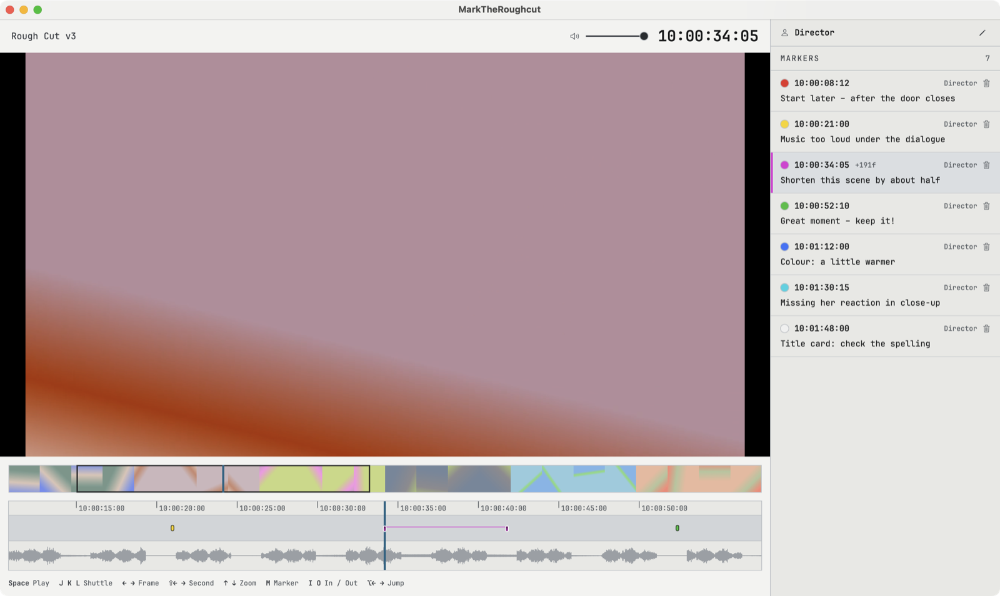
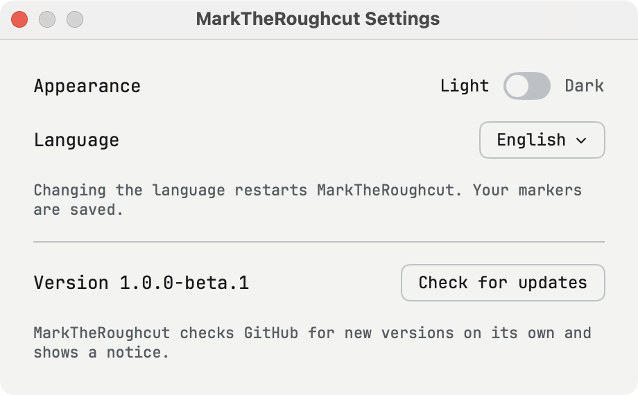

# MarkTheRoughcut

A simple Mac player for directors: watch a rough cut, set markers with comments and send them to the editor as a marker list for **Avid Media Composer**.

*English · Deutsch · Français · Español – Settings (⌘,) → Language. Manual: Help → MarkTheRoughcut Manual.*

> **Beta.** Please report problems in [Issues](../../issues).

<p align="center"><picture><source media="(prefers-color-scheme: dark)" srcset="assets/screenshots/main-dark.png"></picture></p>

## Features

- Plays everything QuickTime Player plays (MOV, MP4 with H.264, HEVC, ProRes …).
- **Timecode from the file** – markers land exactly where they belong in Avid.
- **Overview bar** with thumbnails, plus a **zoomable timeline** around the playhead (↑/↓) with Avid-style markers and the sound as a waveform.
- Markers with colour and comment; saved automatically next to the video. Your name is shown above the marker list.
- Light or dark appearance, built-in manual in four languages, volume control.

<p align="center"><picture><source media="(prefers-color-scheme: dark)" srcset="assets/screenshots/settings-dark.png"></picture></p>

- **Updates itself:** checks GitHub for new versions and installs them with one click (Settings → Check for updates).
- **Export** an Avid marker list (Markers window → Import Markers). Characters Avid stumbles over (umlauts, “/”, quotes, line breaks) are replaced, so every marker arrives complete.
- **Import** a marker list exported from Avid – e.g. the editor's notes for the director.

## Keys

| Key | |
|---|---|
| Space | Play / pause |
| J / K / L | Shuttle backwards / stop / forwards (press again for faster) |
| ← / → | One frame |
| ⇧← / ⇧→ | One second |
| ⌥← / ⌥→ | Previous / next marker |
| ↑ / ↓ | Zoom the timeline around the playhead |
| M | Set a marker at the playhead |
| I / O | Mark in / out – if you then set a marker (M), it spans from in to out |
| G | Clear in and out |
| ⌫ | Delete the selected marker |
| Esc / Enter | Leave the comment field (or click anywhere else) |

The first marker asks for your name – it appears with every marker in Avid.

## Install

Requires macOS 13 or later, Apple Silicon or Intel. Download `MarkTheRoughcut-<version>.zip` from [Releases](../../releases), unzip, move the app to Applications (so it can update itself). It is not signed with a paid Apple certificate: on first launch, open **System Settings → Privacy & Security** and click **Open Anyway** (once).

## Build

```
swift test                 # VideoInfo tests need ffmpeg (Homebrew) to make test videos
scripts/build-app.sh       # → dist/MarkTheRoughcut.app and a zip
```

`Sources/MarkerCore` – timecode, markers, Avid import/export, reading the file's timecode (tested). `Sources/MarkTheRoughcut` – the app.

## License

Copyright © 2026 Moritz Poth. Free software under the GNU General Public License v3.0 or later – see [LICENSE](LICENSE). No warranty. Font: [JetBrains Mono](https://www.jetbrains.com/lp/mono/) (SIL Open Font License, `Resources/fonts/OFL.txt`).

*Avid and Media Composer are trademarks of Avid Technology, Inc. This project is not affiliated with Avid.*
